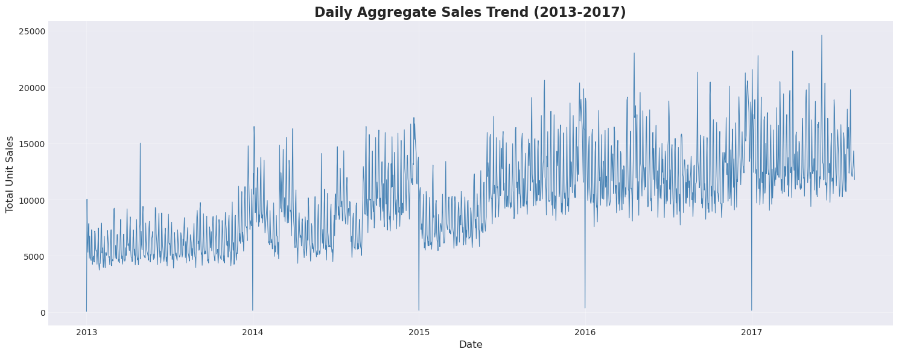
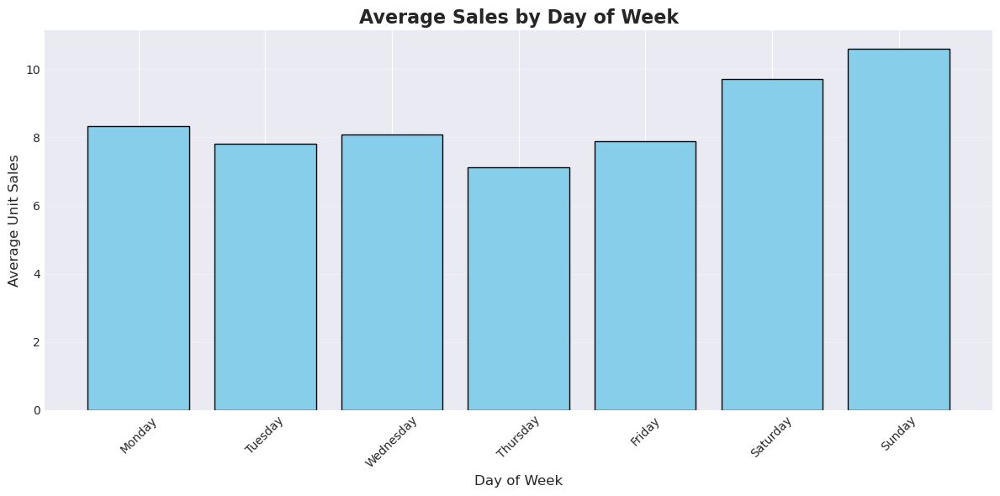
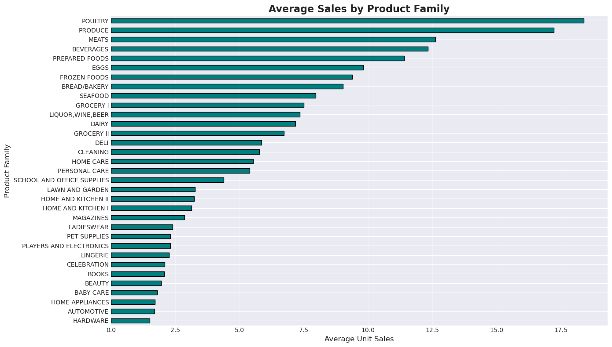
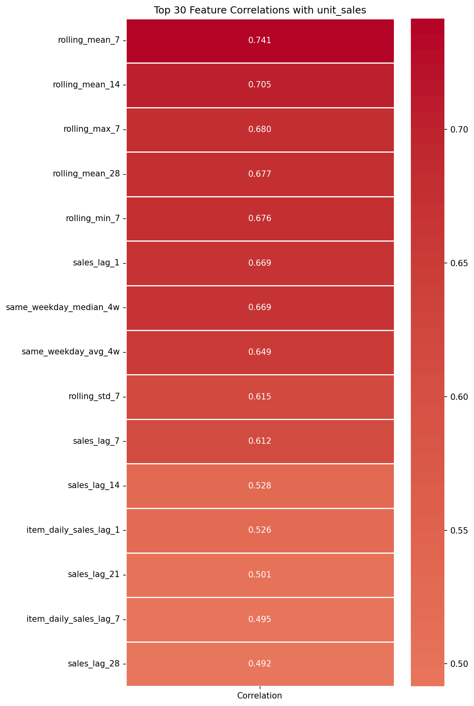

# Grocery Sales Forecasting

Forecasting daily unit sales for thousands of products across 54 Ecuadorian grocery stores, using the [Corporación Favorita](https://www.kaggle.com/competitions/favorita-grocery-sales-forecasting) dataset (125 million rows of store-item-day sales, 2013-2017).

The project covers the full path from raw data to evaluated models: cleaning and merging six source tables, engineering lag, rolling-window, holiday and promotion features on the full dataset, and training gradient-boosted models (XGBoost and LightGBM) that are evaluated on a held-out 16-day window, the same length as the forecast period of the original Kaggle competition.

## Results

All three models are scored on the same held-out test window (2017-07-31 to 2017-08-15), which no model sees during training or tuning.

| Model | Features | Test RMSLE | Test SMAPE | Test NWRMSLE |
|---|---:|---:|---:|---:|
| Baseline XGBoost (untuned, raw features) | 9 | 0.7101 | 0.6109 | 0.7134 |
| XGBoost pipeline | 70 | 0.4895 | 0.4822 | 0.4936 |
| **LightGBM pipeline** | 71 | **0.4875** | 0.4840 | **0.4931** |

- **31% lower test error than the baseline** (RMSLE 0.710 to 0.488), from feature engineering and a disciplined validation setup rather than a different model family.
- **The models generalise.** Train, validation and test RMSLE sit within about 0.02 of each other for both final models (XGBoost: 0.468 / 0.466 / 0.490). The baseline, by contrast, scores 0.068 on training data and 0.710 on test.
- **XGBoost and LightGBM land within 0.002 RMSLE of each other**, which suggests the remaining error is in the features and data rather than the choice of learner.
- Perishable items are harder to forecast than non-perishables (RMSLE 0.503 vs 0.479 for XGBoost), which is why the weighted metric gives them extra weight.

NWRMSLE (Normalized Weighted Root Mean Squared Logarithmic Error) is the metric family used by the original competition. This implementation weights perishable items 2x (the competition used 1.25x). Every figure above is taken from the committed output of the corresponding notebook.

## Approach

**1. Data preparation.** The raw data is six tables: sales transactions, stores, items, oil prices, holidays and store-level transaction counts. `01_load_clean.ipynb` audits each one for nulls and duplicates, fills gaps in the oil price series by interpolation, and writes cleaned files.

**2. Feature engineering at full scale.** `02_eda_feature_engineering.ipynb` merges all tables onto the 125M-row sales table and builds 30 features: calendar features, sales lags, rolling-window statistics, holiday and promotion indicators, store/item aggregates and interactions. The full merge needs tens of gigabytes of memory and was run on a high-memory HPC node.

**3. Leakage control.** The modelling notebooks drop five aggregate features that are computed from same-day sales, then add strictly backward-looking ones: lagged oil prices and transaction counts, lagged item- and store-level daily sales, same-weekday averages, holiday proximity, trend and zero-sales indicators.

**4. Temporal validation.** The final models split the data by date, never at random:

| Split | Dates |
|---|---|
| Train | up to 2017-07-14 |
| Validation (early stopping) | 2017-07-15 to 2017-07-30 |
| Test | 2017-07-31 to 2017-08-15 |

The baseline shares the same test window but validates on a random slice of earlier data, one of the weaknesses the final pipeline corrects.

**5. Modelling.** Models are trained on a sample of 866,805 rows stratified across product families (50 store-item pairs per family) so that the XGBoost and LightGBM runs are directly comparable. XGBoost is trained on GPU; both models use early stopping on the validation window.

## Limitations

- The models are trained and scored on a stratified sample of store-item pairs, not the full 125M rows.
- The feature set includes 1-day lags of actual sales, so the test scores measure next-day forecasts across the 16-day window, not forecasts made 16 days ahead. They are not directly comparable with Kaggle leaderboard scores.

## What the data shows

| | |
|---|---|
|  |  |
| Sales grow steadily over four years with strong weekly cycles and near-zero sales every January 1. | Weekends sell the most; Thursday is the slowest day. |
|  |  |
| Demand varies by an order of magnitude between families, led by poultry, produce and meats. | The 15 features most correlated with the target are all recent-history features: rolling means and short lags. |

Other findings from the exploratory analysis:

- About 6% of rows are on promotion, and promoted items sell more on average (13.46 vs 8.22 units).
- Perishable items sell more per row than non-perishables (10.82 vs 7.78 units).
- The 7-day rolling mean is the top feature in the XGBoost model (by gain) and the 1-day lag is the top feature in LightGBM (by split count).

## Repository layout

```
notebooks/
  01_load_clean.ipynb               Load the raw tables, audit and clean them
  02_eda_feature_engineering.ipynb  Merge, engineer features, exploratory analysis
  03_baseline_xgboost.ipynb         Untuned baseline on raw features
  04_xgboost_pipeline.ipynb         Final XGBoost model
  05_lightgbm_pipeline.ipynb        Final LightGBM model
  exploratory/                      Earlier experiments, kept for reference
data/                               Raw and intermediate data (git-ignored)
results/                            Saved models and metrics
docs/images/                        Figures used in this README
```

The notebooks in `notebooks/exploratory/` record earlier iterations: EDA on a 1% sample, a first XGBoost model on that sample, and two per-horizon experiments that were set aside in favour of the pipeline above. Each one opens with a note on its status and what it showed. The files under `results/` (`training_results_simple.csv` and `models/`) were produced by `exploratory/xgboost_simple.ipynb`; they use a different target scale and are not comparable with the table above.

## Reproducing the results

**Requirements:** Python 3.11. Notebook 02 processes the full 125M-row dataset in memory and needs a high-memory machine. Notebooks 03 and 04 train XGBoost with `device: cuda` and need an NVIDIA GPU.

```bash
git clone https://github.com/Rijifl/grocery-sales-forecasting.git
cd grocery-sales-forecasting
pip install -r requirements.txt
```

Download the data, which is hosted on Kaggle as parquet files. This needs a Kaggle API token: create one under *Settings > API* in your Kaggle account and save the downloaded `kaggle.json` to `~/.kaggle/` (on Windows, `C:\Users\<you>\.kaggle\`).

```bash
kaggle datasets download -d littlesaplings/grocery-sales-forecasting-parquet -p data/raw/ --unzip
```

Then run the notebooks in `notebooks/` in numbered order, starting Jupyter from inside that folder. Paths are relative to the notebook's location: raw files are read from `data/raw/`, and the engineered feature table is written to `results/df_featured_full.parquet`, which notebooks 03 to 05 read.

Note that `unit_sales` in this parquet release is stored as `log1p(unit_sales)`. Notebook 02 converts it back to units before engineering features, and the final models are evaluated on the original scale.

## Project and contributions

This was a team project at Clemson University.

I, Ahmet Dokmeci, was the main contributor and led:

- the exploratory analysis and the full-scale feature engineering pipeline
- the baseline model and the early XGBoost experiments
- the final XGBoost pipeline, including leakage removal and the temporal validation design
- the final LightGBM pipeline and the model comparison

Thanks to my teammates, whose work is recorded in the [commit history of the original repository](https://github.com/apa0/grocery-sales-forecasting/graphs/contributors).

## Data

Sales data is from the [Corporación Favorita Grocery Sales Forecasting](https://www.kaggle.com/competitions/favorita-grocery-sales-forecasting) competition on Kaggle, used here through a [parquet conversion](https://www.kaggle.com/datasets/littlesaplings/grocery-sales-forecasting-parquet) of the original files. The data is not included in this repository.
